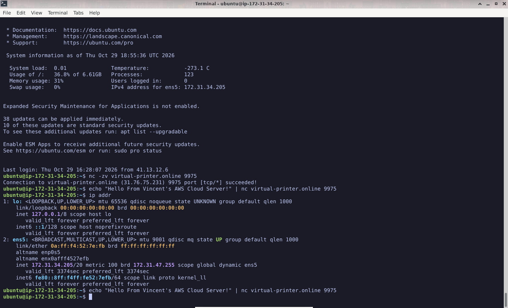

# Ticket 02: Troubleshooting Cloud-to-Network Printer Connectivity

## 📌 Issue Summary
A cloud-based application hosted on AWS needs to send print jobs to a remote network thermal printer. The initial connection test succeeded, but print jobs were being dropped. 

## 🛠️ Environment & Tools Used
*   **Source:** AWS EC2 Instance (Ubuntu 64-bit)
*   **Destination:** Virtual Thermal Printer (`virtual-printer.online` on Port 9975)
*   **Tools:** `netcat` (nc), SSH, TCP/IP

## 🚀 Troubleshooting & Resolution Steps

1.  **Tested Network Connectivity:**
    Used Netcat to verify that the AWS server could reach the remote printer on the correct port:
    `nc -zv virtual-printer.online 9975`
    *Result:* Connection succeeded (TCP port is open).

2.  **Attempted Print Job:**
    Sent a raw text string over the TCP socket to simulate a print job:
    `echo "Hello from AWS" | nc virtual-printer.online 9975`
    *Result:* The print job failed. 

3.  **Identified the Root Cause (IP Whitelisting):**
    Checked the printer's admin dashboard and discovered the connection was blocked by an **IP Whitelist**. The printer rejected connections from the AWS server's public IP (`16.28.92.187`) because it was unrecognized. 

4.  **Resolution:**
    Added the AWS Public IPv4 address to the printer's IP Whitelist via the web dashboard.

5.  **Verification:**
    Re-ran the `echo` command to send the raw TCP payload. The virtual printer successfully received the data and rendered the document on the web interface.

## 🎓 Key Learnings
*   **Cloud IPs are dynamic:** AWS Public IPs change if an instance is stopped and started. In a production environment, an Elastic IP (EIP) should be used to ensure the printer whitelist remains valid.
*   **Layered Security:** Even if a port is open at the network level, application-level security (like IP whitelists) can still block traffic.

## 📸 Proof of Work (Screenshots)

Here is the visual proof of the troubleshooting process:

### 1. Testing Connectivity & Sending the Print Job
Using Netcat (`nc`) to verify the port was open and sending the raw TCP payload from the AWS Cloud Server.

### 2. The Final Result: Virtual Printer Dashboard
The remote printer successfully received the data over the public internet after adding the AWS IP to the whitelist.

